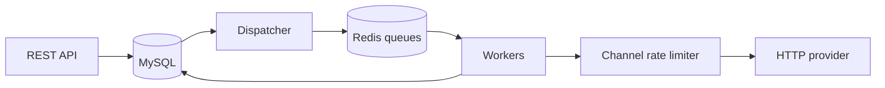

# Notification System

A Laravel service for sending SMS, email and push notifications asynchronously. The main goal is to keep API requests independent of delivery, handle concurrent requests safely and make notification status easy to track.

**Stack:** PHP 8.3, Laravel 12, MySQL 8.4, Redis 7, Docker Compose.

## Getting started

Docker with Compose 2.24+ is required. From the project directory, create a local environment file and start the services:

```bash
sed "s|^APP_KEY=.*|APP_KEY=base64:$(openssl rand -base64 32)|" .env.example > .env
docker compose up -d --build
docker compose ps -a
```

Keep your existing `.env` if the application is already configured. The default provider is a local HTTP simulator. The migration service exits with code 0 once the database is ready.

- Dashboard: http://localhost:8000
- Health: http://localhost:8000/api/health
- Metrics: http://localhost:8000/api/metrics
- API documentation: [OpenAPI specification](openapi.yaml)

The dashboard uses the same REST API as external clients. It supports single and batch requests, scheduling, cancellation, status queries and filtering. Metrics refresh every five seconds when automatic refresh is enabled.

## API

| Method | Endpoint |
| --- | --- |
| POST | `/api/notifications` |
| POST | `/api/notifications/batch` |
| GET | `/api/notifications` |
| GET | `/api/notifications/{id}` |
| GET | `/api/batches/{id}` |
| POST | `/api/notifications/{id}/cancel` |
| GET | `/api/metrics` |
| GET | `/api/health` |

Create a notification:

```bash
curl -i http://localhost:8000/api/notifications \
  -H 'Content-Type: application/json' \
  -H 'Accept: application/json' \
  -H 'Idempotency-Key: order-101-sms' \
  -d '{"recipient":"+905551234567","channel":"sms","content":"Your order has shipped.","priority":"high"}'
```

The API returns `202 Accepted` with a batch ID and notification IDs. A batch request uses the same notification fields inside a `notifications` array and accepts up to 1,000 items.

Each notification requires `recipient`, `channel`, `content` and `priority` (`high`, `normal`, `low`). To schedule a notification, include `scheduled_at` in ISO 8601 format with a timezone. SMS content is limited to 160 Unicode characters, push to 4,096 and email to 10,000. SMS and email recipients are validated by channel.

Creation requests require an `Idempotency-Key` (1–200 printable ASCII characters without spaces). Reusing a key with the same payload returns the existing records. Reusing it with a different payload returns `409 Conflict`.

The list endpoint supports `status`, `channel`, `from`, `to`, `page` and `per_page` (up to 100). Date-only filters use UTC; the end date includes the full day. Batch results are paginated at 100 items. Invalid inputs return `422`, missing records return `404`, and only pending notifications can be cancelled.

## Architecture



MySQL stores the notification and batch records in a single transaction. Redis handles the queues and channel rate limiting. Keeping these responsibilities separate allows workers to scale independently of the API.

The dispatcher leases eligible records using `FOR UPDATE SKIP LOCKED`. If publishing to Redis fails or the dispatcher stops, expired leases make the records eligible for dispatch again. Workers use conditional database updates to claim notifications and avoid competing sends. Normal and low priorities have dedicated workers so high-priority traffic cannot consume all worker capacity.

The rate limiter uses an atomic Redis Lua script and a one-second sliding window. Each channel has a shared limit of 100 provider attempt admissions per second across workers. A rate-limited job is deferred without increasing its delivery attempt count.

## Delivery and error handling

A notification starts as `pending`, moves to `processing`, and finishes as `accepted`, `failed` or `unknown`. A pending notification may also become `cancelled`.

| Provider result | Action |
| --- | --- |
| Valid HTTP 202 | Mark as accepted and save provider ID |
| HTTP 429 | Retry with exponential backoff, jitter and Retry-After; maximum five attempts |
| Other definite client rejection | Mark as failed |
| Timeout, HTTP 408, 5xx or unexpected response | Mark as unknown |

Stale processing claims are marked `unknown` after two minutes. The external provider does not guarantee idempotency, so retrying ambiguous responses could send the same notification twice. Exactly-once delivery cannot be guaranteed without provider-side idempotency and reconciliation. `accepted` means the provider accepted the request, not that the recipient received it.

## Observability

Worker logs are JSON formatted and include notification and correlation IDs. The same correlation ID is forwarded to the provider. The health endpoint checks MySQL and Redis connectivity.

Metrics include queue depth, due pending records, success/failure rates and average creation-to-acceptance latency over the last 24 hours. Cancelled and unknown notifications are excluded from the rate calculation. Scheduled waiting time is included in latency.

```bash
docker compose logs --tail=100 api dispatcher worker worker-normal worker-low
docker compose exec api php artisan queue:failed
```

## Webhook.site integration

Create a private URL at [webhook.site](https://webhook.site/) and configure HTTP status `202`, content type `application/json` and a response body such as:

```json
{"messageId":"demo-uuid","status":"accepted","timestamp":"2026-11-26T12:00:00Z"}
```

Cancel outstanding mock test notifications before changing providers. Set `PROVIDER_URL` in `.env` to your webhook URL and recreate the application services:

```bash
docker compose up -d --force-recreate api dispatcher worker worker-normal worker-low
```

Submit a new notification with synthetic recipient data. Check that the webhook receives `to`, `channel` and `content`, plus the `Idempotency-Key` and `X-Correlation-ID` headers. The notification should move to `accepted`. Do not commit `.env` or private webhook URLs.

## Tests

```bash
docker compose run --build --rm test sh -c 'composer lint && composer test'
python3 scripts/smoke.py
```

PHPUnit uses an isolated SQLite database, HTTP fakes and a real Redis rate limiter check. The smoke test requires Python 3.9+ and the running Docker stack with the local mock provider. It covers concurrent idempotency, all channels, validation, priority routing, scheduling, cancellation, retries, metrics and the batch size limit. It leaves 1,000 scheduled test records; use disposable data and cancel or remove those records before switching providers.

GitHub Actions is configured to run lint, PHPUnit and the smoke test.

## Scope and limitations

This deployment is intended for local evaluation. The API is bound to loopback and uses PHP's development server. A production deployment would need authentication, tenant isolation, a production HTTP runtime, provider reconciliation, secret management, worker monitoring and retention policies. The dashboard uses polling, not WebSockets. Templates and distributed tracing are not implemented. The rate limiter controls admission times, not network arrival times; capacity under sustained traffic still needs benchmarking.

Stop the services without deleting data:

```bash
docker compose down
```
